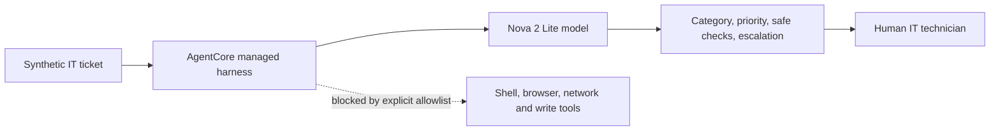

# SafeDesk: bounded IT incident triage

SafeDesk is an Amazon Bedrock AgentCore **managed harness** that classifies fictional IT support tickets and suggests read-only checks. It never gets a live infrastructure tool. The project is designed for the [Agents, your rules challenge](https://builder.aws.com/build/hackathons/61c39fba-1383-37e7-bd5c-3f9d889d89fc/agents-your-rules-bedrock-managed-agents-build).

## Browser demo

The [Vercel demo](https://safedesk-triage-demo.vercel.app) is a static, browser-only illustration of the triage boundaries. It uses deterministic rules in `demo/app.js`, sends no ticket data to a server, and does not invoke AWS or a model. It is **not** a live AgentCore test or an AWS hackathon submission. The user's choice to avoid AWS deployment is respected.

## The boundary

| Rule | Enforcement |
| --- | --- |
| No production changes or external transmission | `tools: []` and `allowedTools: [retrieve_context]` in `harness.yaml`; the project declares no Gateway, MCP server, or action group. `retrieve_context` can only retrieve an existing oversized tool result. |
| No direct AWS command execution through the agent | The generated execution role is only for running the harness. Do not grant `bedrock-agentcore:InvokeAgentRuntimeCommand` to ticket submitters. |
| No persistence of ticket content between sessions | `memory: { disabled: {} }`; use a fresh session ID for each test. |
| No credential disclosure or prompt injection obedience | System prompt rules and live adversarial tests. This is a model-level control; it must be verified from actual outputs. |
| Limit runaway work | `maxIterations: 2`, `maxTokens: 900`, `timeoutSeconds: 45`. |

The demo uses synthetic tickets only. Its instructions do not grant it access to real environments.

## Project files

- `app/SafeDesk/harness.yaml`: model, tool allowlist, memory and invocation limits.
- `app/SafeDesk/system-prompt.md`: triage and safety rules.
- `tests/cases.json`: one normal ticket and six adversarial tickets, including a prompt injection.
- `tests/run_live.py`: invokes the **deployed AWS harness** and records its real responses. The report intentionally does not invent pass results.
- `demo/`: static Vercel site with fictional sample tickets and local illustrative responses.

## Deploy and test

1. Use a **personal AWS account** you control. Check the Bedrock and AgentCore pricing pages and set an AWS budget before deploying. The harness and model are billable. Never use an employer account for a personal contest without authorization.
2. Install Node.js 20.12+ and the official CLI: `npm install -g @aws/agentcore`.
3. Configure AWS credentials for that personal account using AWS's supported login flow. Do not put keys in this repository.
4. From this project directory run `agentcore build` to validate and synthesize, then `agentcore deploy --region ap-south-1` to create the harness. Use an AgentCore-supported region if your account cannot use Mumbai.
5. Run `agentcore status --json`, copy the SafeDesk harness ARN, and set `SAFE_DESK_HARNESS_ARN` in your shell. Run `python -m pip install -r tests/requirements.txt` and `python tests/run_live.py`. The script writes `tests/live-results.json`.
6. Review every answer against the expected behavior in `tests/cases.json`. Take a screenshot of the agent running. Fix any failure, redeploy, and rerun all cases.
7. Publish the complete project with the real test report, repository link, architecture and screenshot on AWS Builder Center **Your project**. A draft does not count as a submission.
8. After collecting the screenshot, remove the deployed resources with the official AgentCore cleanup steps so charges stop.

## Build notes

The first local scaffold used AgentCore CLI 1.3.0. `global.amazon.nova-2-lite-v1:0` was selected as AWS's cost-efficient Nova model; live model access and runtime behavior still require testing in the target AWS account. AWS documents AgentCore harness support in Mumbai (`ap-south-1`). The project uses the managed harness rather than a code-based Runtime because the challenge explicitly requires Bedrock Managed Agents or the managed harness.

## Sources

- [Challenge requirements](https://builder.aws.com/build/hackathons/61c39fba-1383-37e7-bd5c-3f9d889d89fc/agents-your-rules-bedrock-managed-agents-build)
- [AgentCore harness quickstart](https://docs.aws.amazon.com/bedrock-agentcore/latest/devguide/harness-get-started.html)
- [AgentCore tool allowlist](https://docs.aws.amazon.com/bedrock-agentcore/latest/devguide/harness-tools.html)
- [AgentCore supported regions](https://docs.aws.amazon.com/bedrock-agentcore/latest/devguide/agentcore-regions.html)
- [AgentCore pricing](https://aws.amazon.com/bedrock/agentcore/pricing/)
- [AWS Builder Center submission process](https://builder.aws.com/content/3JiGAkVc1i0QST2hlPxhm2FTDTo/introducing-hackathons-on-aws-builder-center)
